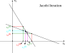

# Linear Equations

1. **Homogeneous**: $\sum_{i = 0}^n a_ix_i = 0$ . Only one solution, **trivial**; infinitely many solutions, **non-trivial**.

2. **LU decomposition**: 

   1. **L**: the multiplier you use to eliminate an entry gets written into L at that same position, with 1s along the diagonal.

   2. **Advantage**: when with different bs, you needn't do gaussian's elimination to different bs.

3. **Norm**: a function from the space of vector to space of scalar, denoted by $||(.)||$

   1. For a **finite** dimensional vector: $\|\mathbf v\|_p^p=\sum_{i=1}^n|v_i|^p$

   2. For a **infinite** dimensional vector: $\|\mathbf v\|_\infty=\max_i|v_i|$

4. Jacobi Iteration:

   To a linear equation series:

   $$
   \begin{cases}
   a_{11}x+a_{12}y=b_1\\
   a_{21}x+a_{22}y=b_2
   \end{cases}
   $$

   We have (choose the variable with the largest absolute coefficient, help speed up the convergence):

   $$
   \begin{cases}
   x^{(k+1)} = \dfrac{b_1-a_{12}y^{(k)}}{a_{11}} \\[10pt]
   y^{(k+1)} = \dfrac{b_2-a_{21}x^{(k)}}{a_{22}}
   \end{cases}
   $$

   
